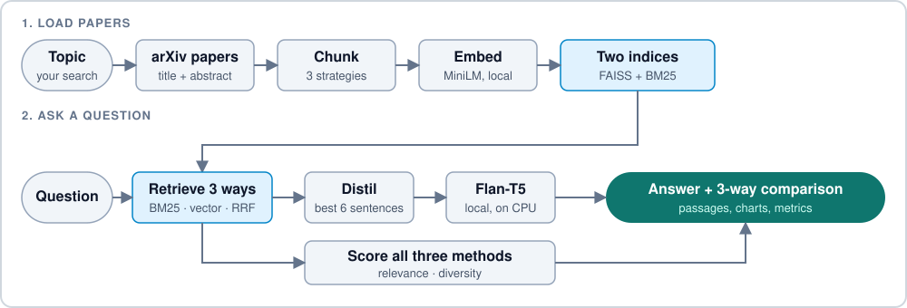
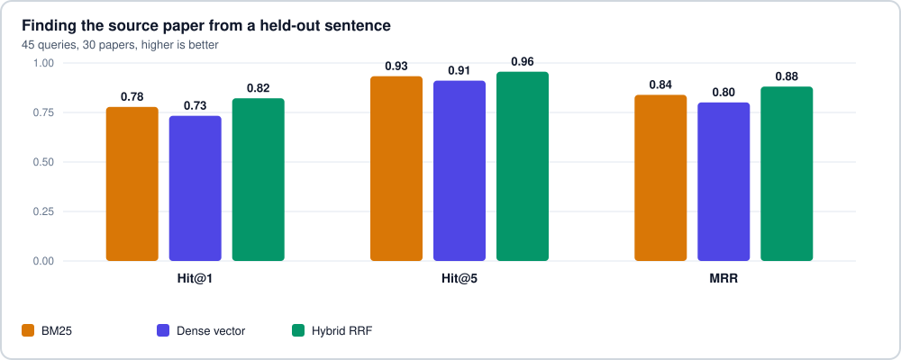

<div align="center">

# research-rag-bench


[](https://huggingface.co/spaces/mnoorchenar/research-rag-bench)
[](https://mnoorchenar.github.io/)

[](https://www.python.org/)
[](https://flask.palletsprojects.com/)
[](https://dash.plotly.com/)
[](https://github.com/facebookresearch/faiss)
[](https://www.docker.com/)
[](../LICENSE)

**Most RAG demos show one retriever and ask you to trust it.**<br>
research-rag-bench runs BM25, dense vector and hybrid search on the same arXiv papers, side by side, so you can see which one finds the right passages.

[](#features) [](#how-it-works) [](#results) [](#documentation) [](#author)

<table>
  <tr>
    <td align="center"><h3>96%</h3>of held-out queries found their paper in the top 5 with hybrid search</td>
    <td align="center"><h3>3</h3>retrieval methods compared side by side on every question</td>
    <td align="center"><h3>41</h3>automated tests, none needing network or a model download</td>
    <td align="center"><h3>$0</h3>to run, with local models on a free CPU Space</td>
  </tr>
</table>

</div>

## Features

<table>
  <tr>
    <td width="50%"><b>Three retrievers, one page</b><br>Every question runs BM25, dense vector (FAISS) and hybrid search, and shows their passages, scores and metrics together.</td>
    <td width="50%"><b>Hybrid search from scratch</b><br>Reciprocal Rank Fusion is about ten lines of code, with no retrieval framework hiding what happens.</td>
  </tr>
  <tr>
    <td><b>Real arXiv papers</b><br>Search any topic and index up to 10 papers in one click, using sentence-window, fixed-size or paragraph-aware chunking.</td>
    <td><b>Live metrics</b><br>Context relevance, diversity and answer overlap are computed for each method, with radar and bar charts.</td>
  </tr>
  <tr>
    <td><b>Local answers</b><br>A Flan-T5 model (base, large or XL) runs on the server's CPU, so there is no API key and no rate limit.</td>
    <td><b>Quick-start topics</b><br>One-click topic chips load papers for data science, marketing or medicine and suggest questions to ask.</td>
  </tr>
</table>

## How it works



## Results

Hybrid search found the source paper at least as often as either method alone. To test this without relying on the app's own metrics, two sentences were removed from each paper's abstract before indexing, and each removed sentence became a query for that paper.



<sub>One run on 2026-11-06 over 45 queries and 30 papers, using `all-MiniLM-L6-v2`. The gaps are small: at rank 1, hybrid found 37 papers, BM25 35 and vector 33. That points to hybrid helping, but it isn't a statistically established result, and it measures finding a paper from related wording, not answering real questions. [Rerun it](../scripts/evaluate_retrieval.py) or see the [full data](../docs/evaluation.json).</sub>

## Documentation

<details>
<summary><b>Getting started</b></summary>

Requires Python 3.10+. Models download on first use, about 90 MB for the embedder and about 3 GB for the default Flan-T5 large.

```bash
git clone https://github.com/mnoorchenar/research-rag-bench.git
cd research-rag-bench

python -m venv venv
source venv/bin/activate     # Windows: venv\Scripts\activate
pip install torch            # or the CPU build: see pytorch.org
pip install -r requirements.txt

python wsgi.py
```

Then open http://localhost:7860. Or use Docker, which also downloads both models at build time:

```bash
docker build -t research-rag-bench .
docker run -p 7860:7860 research-rag-bench
```

</details>

<details>
<summary><b>Engineering decisions</b></summary>

| Decision | Why |
|---|---|
| Fuse rankings with Reciprocal Rank Fusion (k=60) | Cosine similarity and BM25 scores are on different scales. Fusing ranks avoids calibrating them against each other. |
| Reduce the retrieved text to its 6 most relevant sentences before answering | Flan-T5 has a short input window, and abstract chunks contain titles and filler that distract it. |
| Fall back to the retrieved sentences when the model refuses | A small model can answer "not enough information" even when the text is relevant. Showing the evidence is more useful than a refusal. |
| Measure retrieval with held-out sentences | The live relevance metric uses the same embedding model as the vector retriever, so it favors that retriever. The held-out task doesn't. |
| Run all models locally | There is no key to manage and no quota to hit, at the cost of slower answers on a CPU. |
| Download models when the image is built | The first question doesn't wait for a multi-gigabyte download. |
| Embed only new chunks on each fetch | Earlier embeddings are reused, so adding papers doesn't re-encode the whole index. |
| Rebuild the indices when the saved index is loaded | Only chunks and embeddings are saved, so the search indices must be rebuilt after a restart. |
| Return short error messages, not stack traces | The API is public, and tracebacks reveal internals. Details go to the server log. |
| Run one worker with locks around indexing and model loading | The index lives in process memory, so a single process keeps it consistent. |

</details>

<details>
<summary><b>Limitations</b></summary>

- **The benchmark is small.** It has 45 queries, one embedding model and one run. Differences between methods are a few queries.
- **The live metrics are weak.** Context relevance uses the same embedder as the vector retriever, so it favors vector search. Faithfulness is word overlap with the retrieved text, which says nothing about whether an answer is true.
- **Answers are modest.** The models are small, they see only six sentences, and papers are indexed by title and abstract, not full text. Flan-T5 XL is slow on a free CPU (the app's own estimate is about a minute per answer).
- **One index for everyone.** Loading papers replaces what another visitor is searching. On a Space the index is lost on restart, because the container disk is temporary.
- **It depends on arXiv.** Fetching needs arXiv to be reachable and can be rate limited.
- **The first answer is slow.** The first question after a restart loads the model into memory, which takes a while on a free CPU.
- **The API has no authentication or rate limiting.**

</details>

<details>
<summary><b>Configuration</b></summary>

| Variable | Default | Purpose |
|---|---|---|
| `SECRET_KEY` | development default | Flask secret key. Set your own in production. |
| `DATA_DIR` | `data` | Folder where indexed papers are saved |
| `PORT` | `7860` | Port to listen on |

The models are set in `app/models/embedder.py` and `app/models/generator.py`.

</details>

<details>
<summary><b>API</b></summary>

All endpoints take and return JSON.

| Endpoint | Body | Returns |
|---|---|---|
| `POST /api/fetch-arxiv` | `query`, `max_results` (1 to 15), `chunk_strategy` (optional) | Papers and chunks added, and index stats |
| `POST /api/query` | `question`, `method` (`bm25`, `vector` or `hybrid`), `k` (1 to 10), `model_id` (optional) | Answer, retrieved chunks and metrics |
| `POST /api/compare` | `question`, `k` | Results and metrics for all three methods |
| `POST /api/evaluate-batch` | `questions` (up to 10), `k` | Average relevance and diversity per method |
| `POST /api/clear` | none | Empties the index |
| `GET /api/stats` | none | Paper and chunk counts, and index status |

</details>

<details>
<summary><b>Tests</b></summary>

```bash
pip install -r requirements.txt pytest
pytest                                     # Fast tests with embeddings and arXiv faked
python -m scripts.evaluate_retrieval       # Reruns the benchmark on the saved corpus
```

The tests need no network or model download. They cover chunking, the three retrievers and fusion, saving and reloading the index, incremental indexing, metrics, answer fallbacks, the REST API, the benchmark's task construction and this README's copy for Hugging Face. Add `--refresh` to the benchmark to download a new corpus from arXiv.

</details>

<details>
<summary><b>Project structure</b></summary>

```
wsgi.py                     Entry point, used by Gunicorn
app/
  __init__.py               Flask app factory
  services.py               Fetch, chunk, embed and index papers
  store.py                  Documents, chunks, embeddings and search indices
  routes/                   REST API: ingest and query
  models/                   Embedder, retrievers and Flan-T5 generator
  utils/                    arXiv loader, chunkers and metrics
  dashboards/               Dash interface
scripts/
  evaluate_retrieval.py     Held-out sentence benchmark
  sync_readme.py            Builds the Hugging Face README from .github/README.md
docs/                       Figures, evaluation data and corpus snapshot
tests/                      Test suite
Dockerfile                  Gunicorn on port 7860, models baked in
```

</details>

> [!WARNING]
> This project is for research and education only. Generated answers are short, can be wrong, and are based only on paper abstracts, so verify them against the papers. Papers you load are kept in server memory and on disk until cleared or the server restarts.

## Author

<div align="center">
<table>
  <tr>
    <td align="center" width="170">
      <a href="https://mnoorchenar.github.io/"></a>
    </td>
    <td>
      <h3><a href="https://mnoorchenar.github.io/">Mohammad Noorchenarboo</a></h3>
      Data Scientist · AI Researcher · Biostatistician<br>
      Ontario, Canada<br><br>
      <a href="https://mnoorchenar.github.io/"></a>
      <a href="https://www.linkedin.com/in/mnoorchenar"></a>
      <a href="https://scholar.google.ca/citations?user=nn_Toq0AAAAJ&hl=en"></a>
      <a href="https://huggingface.co/mnoorchenar"></a>
      <a href="mailto:mohammadnoorchenarboo@gmail.com"></a>
    </td>
  </tr>
</table>

Released under the [MIT License](../LICENSE).

</div>
